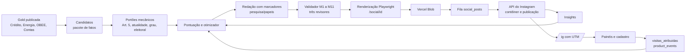

# Pipeline automático de publicações no Instagram

Projeto de distribuição da Scrutiniums no Instagram: identidade visual, escolha de temas, produção, revisão, publicação, medição de engajamento e conversão em usuários da plataforma.

Versão 1, 13/10/2026. Base: `main` no commit `8b27b33`. Documento de desenho; nenhum código de produção foi alterado.

Convenção usada em todo o texto:

* **Evidência**: fato verificado no repositório ou em documentação externa, com fonte e data.
* **Inferência**: conclusão derivada da evidência, sujeita a confirmação.
* **Recomendação**: decisão proposta.

---

## 0. Decisão em uma página

**Objetivo.** Transformar a gold dos observatórios em publicações recorrentes no Instagram que gerem interação qualificada e tragam visitantes rastreáveis para os painéis e para o cadastro.

**Métrica norte.** Cadastros concluídos com origem Instagram por mês. Métricas de apoio: interação ponderada por alcance (seção 7.3) e visitas atribuídas ao Instagram por mil contas alcançadas.

**Arquitetura em uma linha.** Gold publicada → candidatos de pauta com pacote de fatos → pontuação e escolha → redação com números inseridos por código → validador mecânico e três revisores (infraestrutura de `pesquisa/` já existente) → renderização com Playwright nos componentes reais → fila → publicação pela API oficial → coleta de insights → aprendizado da pauta.

**O que já existe e será reaproveitado.** Gold com proveniência nos três observatórios, central de alertas, síntese por regras da Energia, números citáveis com grau de evidência em `/imprensa`, gerador de imagem de gráfico da Energia, scripts de captura com Playwright, constituição editorial e o pipeline de notas com validador, sentinelas, três revisores e auditor.

**O que falta e bloqueia a meta de usuários.**

1. Visitante anônimo não é medido. `POST /api/telemetria` só grava com sessão ativa e não há captura de UTM ou referência. Sem isso, nenhum resultado do Instagram em usuários pode ser atribuído.
2. O cadastro termina em lista de espera para quem não tem código de acesso. Tráfego do Instagram vira fila, não usuário.
3. Não existem credenciais da Meta, conta profissional vinculada nem armazenamento público de mídia.

**Decisões que dependem de você** (detalhadas na seção 12):

| # | Decisão | Recomendação |
|---|---|---|
| D1 | Conta: criar perfil institucional novo ou usar um existente | Perfil novo `@scrutiniums`, conta profissional, sem vínculo com perfil pessoal |
| D2 | Código de acesso dedicado ao canal Instagram | Sim, um código por canal em `ACCESS_CODES`, que também serve de atribuição |
| D3 | Pausa eleitoral até o segundo turno de 25/10/2026 | Sim para contas estaduais e OBEE; crédito e energia liberados |
| D4 | Autonomia de publicação | Mesma escada da constituição: modo sombra, depois publicação automática |
| D5 | Armazenamento de mídia | Vercel Blob (mesmo fornecedor do deploy) |
| D6 | Verba de impulsionamento | Zero na fase 1; decidir após 8 semanas de linha de base orgânica |

**Prazo.** 10 semanas até operação automática estável, em 5 fases com critério de saída (seção 11).

---

## 1. Diagnóstico

### 1.1 Evidência: ativos aproveitáveis

| Ativo | Onde | Uso no pipeline |
|---|---|---|
| Central de alertas, 17 alertas em 5 famílias (macro 2, carteira 4, openfinance 2, antecedentes 0, operacional 9), com nível, fonte, referência e série recente | `public/obs/data/gold/alertas_central.json`, `gerado_em` 24/09/2026 | Pilar "Alerta" |
| Síntese da Energia: 6 frases construídas por regra, cada trecho com ponteiro de evidência para a gold, natureza do dado e regra | `public/energia/gold/sintese.json`, `gerado_em` 01/10/2026 | Matéria prima mais próxima de legenda pronta |
| Números citáveis com grau de evidência A a E | `/imprensa`, a partir de `sintese` em `bets.json`, `fraudes.json`, `operacional.json` | Pilar "Número em contexto" |
| Recordes com janela mínima e método declarados | `public/obs/data/gold/recordes.json` | Gatilho de pauta, sempre com régua explícita |
| Diagnóstico diário determinístico | `/resumo`, `src/lib/dadosPublicos.ts` | Pilar "Pulso" |
| Catálogo de 46 abas do Observatório de Crédito com título e descrição de compartilhamento | `src/lib/data/observatorioAbas.ts` | Destino de cada post e texto de apoio |
| Proveniência por arquivo: `gerado_em`, versão do pipeline, sha256, data de referência | cabeçalho de toda gold de Energia; `meta.json` com `vintages` no Crédito; `meta.proveniencia` no OBEE | Rodapé do post e pacote de reprodução |
| Gerador de imagem de gráfico com título, unidade, fonte, versão e URL | `src/lib/energia/imagem-grafico.ts`, `src/components/energia/BaixarImagem.tsx` | Base do renderizador |
| Captura com Playwright | `scripts/obee/capturas.mjs`, `scripts/energia-capturas-redesenho.mjs` e cerca de 30 outros | Renderização dos posts |
| Constituição editorial v2 e pipeline de notas | `docs/CONSTITUICAO.md`, `pesquisa/` (validador M1 a M11, sentinelas, três revisores, auditor, registro de erros) | Portão editorial do Instagram |
| Design system com acento por observatório e selos de natureza do dado | `tailwind.config.ts`, `docs/observatorios/DESIGN_SYSTEM_OBSERVATORIOS.md`, `src/components/evidencia/SeloNatureza.tsx` | Identidade visual dos posts |
| Atualização diária automática | `atualizar-dados.yml` 09:00 UTC; `atualizar-energia.yml` 23:40 UTC | Relógio da pauta |

Fonte de todas as linhas: repositório, commit `8b27b33`, lido em 13/10/2026.

### 1.2 Evidência: restrições

* **Constituição, Art. 1.** Número só vem da gold ou de pacote de fatos derivado por fórmula declarada. Texto referencia fatos por identificador; o valor é inserido mecanicamente.
* **Constituição, Art. 5.** Bloqueio mecânico de: instituição financeira nominada; FGC, garantia de depósitos, regimes de resolução; Open Finance e participantes; tese nova além dos fatos.
* **Constituição, Art. 7.** Português do Brasil, sem hífen ou travessão em prosa, sinal de menos em negativos, nenhum adjetivo de valor ("forte", "preocupante", "recorde") sem régua declarada, nenhum vocabulário de recomendação, nota ou previsão.
* **Constituição, Art. 9.** Publicação exige degrau 2: três ciclos limpos e pelo menos 90% dos erros plantados detectados. Erro publicado rebaixa o tipo ao degrau 1.
* **Constituição, Art. 10.** Errata datada; o original nunca é apagado.
* **OBEE e contas estaduais.** Teste automático proíbe termos avaliativos ("eficiente", "desperdício", "melhor", "pior", "ranking", "merece atenção", "sinaliza", "excesso"), cores de semáforo, nota geral e ranking de governo. Ordem padrão alfabética (`docs/obee/VALIDACAO.md`, `docs/contas-publicas-estaduais/FASE_1.md`).
* **Energia.** Frases automáticas sem verbo causal.

### 1.3 Evidência: lacunas

* `product_events` tem apenas `id, user_id, name, created_at` (`src/lib/schema.ts`). Visitas são registradas só com sessão (`src/app/api/telemetria/route.ts`). Não há UTM, referência ou campanha em nenhum ponto do código.
* Sem rota de imagem Open Graph (`opengraph-image`), sem `next/og`. A SPA do Crédito usa uma imagem estática única `obs/og-image.png`.
* Nenhum segredo de rede social ou de API de modelo de linguagem nos workflows; o único segredo é `BOLETIM_SECRET`.
* Playwright não é dependência do projeto; os scripts o carregam de `/opt/node-tools`. Em GitHub Actions precisa ser instalado no job.

### 1.4 Inferência

1. O gargalo para "mais usuários" não está no Instagram, está na medição e na porta de entrada. Sem atribuição de visitante anônimo e com cadastro que termina em lista de espera, qualquer ganho de alcance fica invisível ou represado.
2. A constituição elimina os ganchos mais usados para engajamento (adjetivo, alarme, opinião, previsão). O pipeline precisa competir com outros instrumentos: pergunta, identificação regional, utilidade prática, contraste factual e transparência de método. Isso é viável e diferencia a marca, mas exige mais engenharia de formato.
3. Das 5 famílias da central de alertas, `openfinance` está vetada pelo Art. 5, e `operacional` é construída por instituição (CVM e ESTBAN por banco), portanto também vetada enquanto houver nome de instituição. O estoque elegível de alertas hoje é pequeno; a pauta precisa vir majoritariamente dos painéis, não da central.
4. O arquivo `alertas_central.json` publicado tem `gerado_em` de 24/09/2026, 19 dias antes desta leitura, apesar do workflow diário. Pode ser comportamento esperado (alertas só mudam quando a fonte muda) ou falha silenciosa; o portão de atualidade do pipeline precisa distinguir os dois casos.

---

## 2. Objetivos, métricas e metas

### 2.1 Árvore de métricas

| Camada | Métrica | Fonte do dado | Existe hoje |
|---|---|---|---|
| Alcance | Contas alcançadas, visualizações | Insights da API do Instagram | Não |
| Interação | Interação ponderada por alcance (IPA, seção 7.3) | Insights da API | Não |
| Interesse | Toques no link do perfil, visitas ao perfil, novos seguidores | Insights de conta | Não |
| Visita | Sessões com `utm_source=instagram`, por post | Tabela nova de visitas atribuídas | Não |
| Cadastro | `onboarding_started` e `onboarding_completed` com origem Instagram | `product_events` com eventos novos | Parcial (sem origem) |
| Retenção | Usuários de origem Instagram com visita em 30 dias | `product_events` | Parcial |

### 2.2 Referências externas

| Referência | Valor | Fonte e data |
|---|---|---|
| Mediana de taxa de engajamento por post no Instagram, todos os setores | 0,36% dos seguidores | Rival IQ, Social Media Industry Benchmark Report 2025, publicado em fevereiro de 2025 (via resumos secundários) |
| Quartil superior do mesmo painel | cerca de 1,0% | Idem |
| Mediana do setor com maior taxa (ensino superior) | 2,10% | Idem |
| Engajamento médio por formato, 2025 | carrossel 0,55%; reels 0,52% | Socialinsider 2025, via resumo secundário; painel e definição diferentes do Rival IQ |

**Ressalva.** Definições de engajamento variam (denominador seguidores ou alcance; com ou sem salvamentos). Nenhuma dessas referências é diretamente comparável à IPA definida aqui. Servem para ordem de grandeza, não para meta contratual.

**Dado inexistente.** Não há linha de base própria: a Scrutiniums não tem perfil no Instagram nem atribuição de tráfego. Qualquer meta em usuários antes de 8 semanas de operação seria estimativa sem base, e por isso não é fixada aqui.

### 2.3 Metas

| Prazo | Meta | Natureza |
|---|---|---|
| Semana 4 | Atribuição de origem funcionando para 100% das visitas vindas do link do perfil | Verificável em teste |
| Semana 10 | Taxa de engajamento por seguidores igual ou superior a 1,0% (quartil superior Rival IQ 2025) | Referência externa |
| Semana 10 | Linha de base própria de visitas e cadastros por mil contas alcançadas | Medição |
| Semana 12 | Meta de cadastros fixada sobre a linha de base, com intervalo | A definir com dado próprio |

---

## 3. Identidade visual

### 3.1 Princípio

O Instagram recebe a mesma linguagem editorial dos painéis, não uma linguagem de marketing. O post deve ser reconhecível como Scrutiniums a um metro de distância: fundo papel, título serifado, uma única cor de acento por observatório, fonte e data sempre visíveis. Essa coerência é o ativo de marca e também o argumento de confiança que justifica salvar e compartilhar.

### 3.2 Formatos

| Formato | Dimensão | Uso |
|---|---|---|
| Carrossel de feed | 1080 x 1350 (4:5), até 10 lâminas | Formato principal |
| Imagem única de feed | 1080 x 1350 | Número em contexto, errata |
| Reels | 1080 x 1920 (9:16), 15 a 35 segundos | Gráfico em revelação progressiva |
| Story | 1080 x 1920 | Chamada diária para o post do dia e para painéis |
| Capa de reels na grade | recorte central 1080 x 1350 | Coerência da grade |

Evidência (documentação de publicação da Meta, consultada em 13/10/2026): imagens só em JPEG; carrossel com até 10 itens; todas as lâminas são recortadas na proporção da primeira, com padrão 1:1 quando não informada. Por isso a primeira lâmina sempre sai em 4:5.

### 3.3 Grade e zonas

* Margem externa de 72 px; grade de 6 colunas com calha de 24 px.
* Cabeçalho fixo em 96 px: rótulo do observatório e do pilar em Archivo Narrow, caixa alta, espaçamento 0,14em.
* Rodapé fixo em 120 px: fonte primária, data de referência, selo de natureza do dado, endereço curto do painel e paginação "3/7".
* Em reels e stories, títulos e rodapé ficam fora das faixas superior e inferior cobertas pela interface do aplicativo. As faixas exatas serão medidas no piloto com captura real, porque a Meta não as publica na documentação de API.

### 3.4 Tipografia

As três famílias já licenciadas e carregadas localmente em `src/fonts` (Playfair Display, Inter, Archivo Narrow; todas sob licença OFL).

| Papel | Família | Corpo em tela de 1080 px |
|---|---|---|
| Título da capa | Playfair Display 500 | 72 a 88 px, entrelinha 1,1 |
| Título interno | Playfair Display 500 | 56 a 64 px |
| Número de destaque | Inter 600, algarismos tabulares | 120 a 160 px |
| Texto | Inter 400 | 34 a 40 px, entrelinha 1,45, até 38 caracteres por linha |
| Rótulos e unidades | Archivo Narrow 500, caixa alta | 26 a 30 px |
| Rodapé | Inter 400 | 24 px, cor mineral |

Corpo mínimo de 24 px em tela de 1080 px. Formato brasileiro de números e datas. Sinal de menos tipográfico em negativos.

### 3.5 Cor

| Papel | Token | Valor |
|---|---|---|
| Fundo | `papel` | `#FAF8F2` |
| Fundo alternativo (capa de série, errata) | `marfim` | `#F3EFE5` |
| Texto | `carvao` | `#1A1D21` |
| Texto secundário | `mineral` | `#6B6D6A` |
| Regras | `linha` | `#D8D2C6` |
| Acento Crédito e marca | `bronze` | `#966B48` |
| Acento Energia | `energia` | `#0E6170` |
| Acento Eficiência Estatal | `obee` | `#00697F` |
| Acento Contas Públicas | a definir | sem token próprio no repositório; usar `carvao` até decisão |

Regras herdadas do design system: uma cor focal e referências neutras; sem gradiente decorativo, neon ou mostrador; sem verde e vermelho para dizer bom ou ruim; selos de natureza com forma, glifo e cor (observado ●, calculado ◆, estimado ◐, previsto ◌ tracejado, cenário ◇ pontilhado). Contraste de texto AA verificado por script no renderizador, não por inspeção.

### 3.6 Elementos fixos da marca

* Símbolo `src/app/icon.svg` no canto superior direito, 48 px, sem redesenho.
* Assinatura do rodapé: "Scrutiniums · Observatório Brasileiro de [tema]".
* Selo de natureza do dado em toda lâmina com número.
* Lâmina "O que este dado não permite concluir" em todo carrossel analítico. Vem do campo obrigatório do `PainelEvidencia` e é o elemento mais distintivo da marca frente a perfis de opinião econômica.

### 3.7 Biblioteca de modelos

| Código | Modelo | Estrutura | Pilar principal |
|---|---|---|---|
| M1 | Número em contexto | Pergunta, valor, unidade, período, referência de comparação com base declarada | Pulso |
| M2 | Linha do tempo | Série com referência histórica, último ponto rotulado, lacunas visíveis | Pulso, Alerta |
| M3 | Brasil por UF | Mapa coroplético com geometria IBGE e tabela de apoio na lâmina seguinte | Brasil por UF |
| M4 | Distribuição | Pontos por UF ou capital, mediana e destaque de um caso, ordem alfabética no OBEE e em contas estaduais | Brasil por UF |
| M5 | Como funciona | Diagrama curto que distingue fluxo, relação institucional e associação | Explica |
| M6 | Conceito | Definição do glossário, fórmula, exemplo com dado real | Explica |
| M7 | Método aberto | Fonte, tratamento, limitação, link para download | Método |
| M8 | Errata | Fundo marfim, o que foi publicado, o que é correto, data, motivo | Obrigatório |

**Carrossel padrão (7 lâminas).** Capa com pergunta e o número principal → contexto em uma frase → gráfico → segundo recorte ou comparação → "O que este dado não permite concluir" → método e fonte → chamada para o painel com o endereço curto.

**Reels padrão.** Mesmo SVG do gráfico revelado em ritmo lento, legenda gravada na imagem, sem contador animado, sem trilha protegida por direito autoral. Áudio opcional de narração sintetizada a partir do texto aprovado.

### 3.8 Acessibilidade

* Texto alternativo em toda imagem de feed pelo campo `alt_text` (disponível na API desde 24/03/2025, segundo a documentação da Meta; não suportado em reels e stories). O texto alternativo é gerado pelo mesmo contrato do gráfico: tipo de gráfico, variável, unidade, período, valores extremos e último valor.
* Legenda de reels gravada na imagem.
* Contraste AA verificado automaticamente; reaproveitar `axe-core`, já dependência de desenvolvimento.

---

## 4. Escolha de temas

### 4.1 Pilares e mix

| Pilar | Pergunta que responde | Origem na gold | Participação inicial |
|---|---|---|---|
| Pulso | O que mudou na última divulgação? | Nova `vintage` em `meta.json`, `/resumo`, `sintese.json` da Energia | 30% |
| Brasil por UF | Como o meu estado aparece? | `ufs.json`, golds do OBEE, contas estaduais | 25% |
| Explica | O que é e como funciona? | Glossário (`src/lib/data/glossario.ts`), módulo Aprenda da Energia | 20% |
| Alerta | O que a central de alertas registra? | `alertas_central.json`, famílias elegíveis | 10% |
| Método aberto | Como a Scrutiniums mede? | `method.json`, passaporte do OBEE, fichas metodológicas | 10% |
| Calendário | O que sai esta semana? | Calendários oficiais de divulgação | 5% |

Inferência que sustenta o mix: "Brasil por UF" tende a gerar envios por identificação regional, e "Explica" tende a gerar salvamentos por utilidade. Os dois sinais têm o maior peso na IPA (seção 7.3). As participações são ponto de partida; a partir da semana 6 o otimizador (seção 7.5) as ajusta dentro de limites.

### 4.2 Geração de candidatos

Diariamente, depois do `atualizar-dados.yml` e do `atualizar-energia.yml`, o gerador percorre a gold e produz candidatos. Cada candidato é um **pacote de fatos** no mesmo formato de `pesquisa/fatos_conjuntura.py`: identificador de fato, valor, unidade, data de referência, natureza, fonte, ponteiro para o arquivo e campo da gold, sha256 do arquivo.

Gatilhos:

| Gatilho | Regra |
|---|---|
| Divulgação nova | `vintage` da fonte mudou desde o último ciclo |
| Desvio estatístico | Variação fora do intervalo interquartil da série em janela declarada; a régua vai para a legenda |
| Máximo ou mínimo histórico | Entrada em `recordes.json`, com janela mínima e método do próprio arquivo |
| Alerta novo ou mudança de nível | Diferença entre ciclos de `alertas_central.json` |
| Calendário | Data de divulgação oficial nos próximos 7 dias |
| Estoque perene | Conceito do glossário ou módulo Aprenda ainda não publicado |

### 4.3 Portões de elegibilidade (todos mecânicos)

1. **Tema vetado (Art. 5).** Lista de nomes de instituições financeiras derivada de `institutions.json`, termos de FGC, garantia de depósitos, resolução, liquidação e Open Finance. Exclusão integral das famílias `openfinance` e `operacional` da central de alertas e das abas de instituições.
2. **Atualidade.** Data de referência dentro da janela da periodicidade da fonte; arquivo com `disponivel: true`; nenhuma regressão listada em `meta.json`.
3. **Grau de evidência.** Na capa só graus A, B e C da escala de `/imprensa`. D e E podem aparecer no interior com rótulo explícito, nunca como número de capa.
4. **Natureza do dado.** Previsto e cenário só com selo e lâmina de método; a previsão de PLD só quando houver modelo em estado PRODUÇÃO no `registro_modelos.json`.
5. **Neutralidade.** Pacotes de OBEE e contas estaduais passam pelo mesmo teste de termos proibidos do `docs/obee/VALIDACAO.md`; ordenação alfabética ou por região, nunca por valor.
6. **Janela eleitoral.** Bloqueio de pautas de contas estaduais e OBEE entre a data configurada e o fim do segundo turno (decisão D3).
7. **Repetição.** Mesmo indicador publicado nos últimos 21 dias sem nova divulgação é descartado.

### 4.4 Pontuação

Para cada candidato elegível:

```
pontuação = 0,25·novidade + 0,20·magnitude + 0,20·desempenho_esperado
          + 0,15·alcance_regional + 0,10·calendário + 0,10·diversidade
```

| Componente | Cálculo |
|---|---|
| Novidade | Decai com os dias desde a divulgação da fonte, meia vida de 3 dias |
| Magnitude | Percentil do valor ou da variação na própria série histórica, régua registrada |
| Desempenho esperado | Média posterior da IPA do par pilar e modelo no otimizador (seção 7.5) |
| Alcance regional | 1 quando o recorte cobre as 27 UFs, proporcional nos demais casos |
| Calendário | 1 quando coincide com divulgação oficial ou data de interesse do tema |
| Diversidade | Penalidade por observatório ou pilar repetido nos últimos 5 posts |

Pesos são hipótese inicial, registrados em arquivo versionado e reestimados na semana 8 com a regressão da seção 7.5.

**Restrições da semana.** Pelo menos um post por observatório ativo; no máximo dois sobre o mesmo indicador; um post "Explica" por semana no mínimo.

---

## 5. Produção

### 5.1 Redação

* O modelo de linguagem escreve com marcadores de fato (`{F12}`), nunca com números. O renderizador substitui os marcadores pelos valores do pacote, como em `pesquisa/nota.py`.
* Papéis novos em `pesquisa/papeis/`: `redator_instagram.md` (capa, lâminas, legenda, texto alternativo) e `editor_formato.md` (cortes para o limite de caracteres por lâmina). Ambos herdam `comum.md`.
* **Ganchos permitidos.** Pergunta direta ("Quanto do salário vai para dívidas no seu estado?"), contraste factual com base declarada ("Em agosto de 2026, X; em agosto de 2025, Y"), identificação regional, utilidade ("Como ler a bandeira tarifária da sua conta"), transparência ("Como medimos e o que fica de fora").
* **Ganchos vetados.** Adjetivo de valor sem régua, alarme, opinião, previsão sem modelo em produção, comparação implícita de desempenho de governos, causalidade não demonstrada.

### 5.2 Estrutura da legenda

1. Primeira linha: a pergunta da capa, sem número que não esteja na capa.
2. Duas a quatro frases de evidência com marcadores de fato.
3. "O que não dá para concluir:" uma frase.
4. "Fonte:" órgão, série, data de referência. "Atualizado em:" data de captura.
5. Chamada: "Série completa, mapa e download: link no perfil, post nº 0123."
6. Três a cinco hashtags temáticas de um vocabulário fechado por observatório.

Links em legenda não são clicáveis no Instagram; por isso o destino é o link do perfil (seção 8.1) com número do post.

### 5.3 Portão editorial

| Etapa | Instrumento | Existe hoje | Adaptação |
|---|---|---|---|
| Fatos | `pesquisa/fatos_conjuntura.py --verificar` | Sim, para conjuntura | Generalizar para pacotes de qualquer gold |
| Validador mecânico | `pesquisa/validador.py` M1 a M11 | Sim | Regras novas: limite de caracteres por lâmina, vocabulário do OBEE, hashtags do vocabulário fechado, presença das lâminas obrigatórias |
| Revisores | três revisores independentes, unanimidade | Sim | Incluir a imagem renderizada na evidência do revisor de apresentação |
| Sentinelas | `pesquisa/sentinela.py` e `sentinela_semantica.py` | Sim | Bateria própria com erros plantados em posts: número trocado, unidade errada, adjetivo, instituição nominada, ordem por valor no OBEE, data de referência trocada |
| Auditor | `pesquisa/auditor.py` | Sim | Auditoria semanal dos posts publicados contra a gold vigente |
| Registro de erros | `pesquisa/registro_erros.json` | Sim | Canal novo `instagram` |

O post é um novo tipo de nota na escada do Art. 9. Erro publicado gera errata (modelo M8), comentário fixado no post original e rebaixamento ao degrau 1.

### 5.4 Renderização

**Recomendação: Playwright sobre rotas internas do próprio Next.js.**

* Rota `src/app/social/[id]/page.tsx`, `noindex`, protegida por segredo de renderização, que monta cada lâmina com os componentes, fontes e tokens reais, a partir do pacote aprovado.
* `scripts/social/renderizar.mjs` abre a rota em Chromium a 1080 x 1350 ou 1080 x 1920, captura cada lâmina, converte para JPEG qualidade 92 e grava o manifesto com sha256 de cada imagem.
* Reels: gravação de vídeo do Playwright ou quadros PNG costurados por ffmpeg em H.264, 30 quadros por segundo.
* Alternativa descartada: `next/og` (Satori). Exigiria reescrever os gráficos em subconjunto de CSS e duplicar o design system.
* O job instala Playwright e Chromium no GitHub Actions, porque hoje ele não é dependência do projeto.

### 5.5 Armazenamento

A Meta exige que a mídia esteja em URL pública no momento da publicação (documentação de publicação, consultada em 13/10/2026). Recomendação: Vercel Blob, com caminho `social/AAAA/MM/<id>/`, retenção de 90 dias para mídia e permanente para manifesto no repositório em `social/registro/`. Gravar imagens em `public/` aumentaria o repositório e acoplaria o deploy à publicação.

---

## 6. Publicação

### 6.1 Conta e acesso

* Conta profissional do Instagram (empresa) com autenticação em dois fatores.
* App na Meta for Developers com o produto Instagram API com login do Instagram.
* Permissões: `instagram_business_basic`, `instagram_business_content_publish`, `instagram_business_manage_insights`, `instagram_business_manage_comments`. Para a fase de mensagens (seção 8.3), também `instagram_business_manage_messages`.
* Evidência: a documentação exige acesso Standard ou Advanced. Inferência: como o app operará apenas a conta da própria Scrutiniums, com o titular nos papéis do app, o acesso Standard deve bastar sem revisão do app. Confirmar na criação.
* Token de longa duração renovado por job semanal e guardado cifrado no Postgres de produção (tabela `social_credenciais`, chave derivada de `COOKIE_SECRET`), para não depender de reescrever segredos do GitHub.

### 6.2 Fluxo

1. Fila em `social_posts` com estado: `CANDIDATO → REDIGIDO → APROVADO → RENDERIZADO → AGENDADO → PUBLICADO` ou `REJEITADO`, `FALHOU`, `RETIRADO`.
2. No horário, o job confere a cota em `GET /<IG_ID>/content_publishing_limit`.
3. Cria um contêiner por lâmina com `is_carousel_item=true`, depois o contêiner do carrossel com `children`, legenda e `alt_text`.
4. Consulta `status_code` uma vez por minuto, por no máximo 5 minutos, como orienta a documentação.
5. Publica com `POST /<IG_ID>/media_publish`, grava `media_id`, link permanente, hash da legenda e das imagens.
6. Publica comentário inicial com fonte e link curto do painel (texto, não clicável, para quem procura a referência).
7. Chave de idempotência por post impede publicação dupla em nova tentativa.

### 6.3 Limites e cadência

* Evidência: limite de 100 publicações por API em 24 horas móveis, carrossel conta como uma (documentação de publicação da Meta, 13/10/2026). A mesma página cita 50 em outra seção; o pipeline lê o limite vigente no endpoint em vez de fixar o número.
* Cadência proposta, muito abaixo de qualquer limite:

| Fase | Feed | Reels | Stories |
|---|---|---|---|
| Semanas 1 a 4 de publicação | 4 por semana (2 carrosséis, 1 imagem, 1 reels) | incluído | 1 por dia útil |
| A partir da semana 5, se o portão editorial seguir limpo | 6 por semana | 2 por semana | 1 a 2 por dia útil |

* Horários iniciais em teste: 12h15, 18h30 e 21h, horário de Brasília, dias úteis; o otimizador redistribui a partir da semana 6.

### 6.4 Recursos da API usados para crescer

* **Reels de teste (`trial_params`).** Exibidos só para não seguidores, com graduação manual ou automática por desempenho (`SS_PERFORMANCE`). Uso: testar duas capas ou dois ganchos para o mesmo conteúdo sem desgastar a base.
* **Rótulo de conteúdo gerado por IA (`is_ai_generated`).** Gráficos e números são determinísticos e não se enquadram. Recomendação de transparência: biografia do perfil informa "Textos redigidos com apoio de IA sob regras públicas", com link para a constituição.

### 6.5 Limites conhecidos da API

* Adesivos interativos de story (enquete, link, pergunta) não constam na documentação de publicação; inferência: exigem operação manual no aplicativo. O pipeline gera o story e uma ficha com o adesivo sugerido para publicação manual opcional.
* Edição de legenda publicada não é um fluxo previsto no pipeline; correção é sempre errata.
* Filtros e marcação de produtos não são suportados.

### 6.6 Interruptor geral

Variável `INSTAGRAM_PUBLICACAO` com valores `desligada`, `sombra` e `ligada`. Em `sombra`, tudo roda até a renderização e o registro, sem chamar `media_publish`. Qualquer falha de validação, rebaixamento de degrau ou erro da API acima de limiar volta o estado para `sombra` automaticamente.

---

## 7. Análise de engajamento

### 7.1 Coleta

* Insights por post em T+1h, 6h, 24h, 72h, 7 dias e 28 dias: `reach`, `views`, `likes`, `comments`, `shares`, `saved`, `total_interactions`, `follows`, `profile_visits`; em reels também tempo médio assistido e `reels_skip_rate`.
* Insights de conta diários: alcance, seguidores, toques em link do perfil.
* Evidência: `impressions` foi descontinuada para todas as versões em 21/04/2025 e substituída por `views` (referência de insights de mídia da Meta, consultada em 13/10/2026). Os nomes exatos de cada métrica são lidos da versão da API em uso e validados no primeiro dia; métrica ausente é registrada como ausente, nunca como zero.

### 7.2 Modelo de dados

| Tabela | Conteúdo | Dado pessoal |
|---|---|---|
| `social_posts` | Pacote de fatos, textos, hashes, estado, modelo, pilar, observatório, horário, `media_id` | Não |
| `social_metricas` | Instantâneo por post e por janela | Não |
| `social_conta_diaria` | Métricas de conta por dia | Não |
| `social_experimentos` | Braços, alocação, posterior, decisão | Não |
| `visitas_atribuidas` | Contagem agregada por dia, `utm_source`, `utm_campaign`, `utm_content` (número do post) e seção | Não, sem identificador de visitante |

### 7.3 Interação ponderada por alcance (IPA)

```
IPA = (3·compartilhamentos + 2·salvamentos + 2·comentários + 1·curtidas) / contas alcançadas
```

Evidência sobre os pesos: segundo resumos secundários de declarações de Adam Mosseri em janeiro de 2025, tempo assistido, curtidas por alcance e envios por alcance são os principais sinais de distribuição, com envios mais relevantes para alcançar não seguidores. Não localizei a fonte primária; os pesos 3, 2, 2, 1 são hipótese de trabalho e serão substituídos na semana 8 pelos coeficientes que melhor explicam alcance em não seguidores e visitas atribuídas nos próprios dados.

### 7.4 Relatório

* Painel no `/app/admin`, seção Instagram: IPA por post, por pilar, por modelo e por observatório; funil alcance → toques no link → visitas atribuídas → cadastros; posts com maior conversão em visita, não só em interação.
* Relatório semanal automático em `social/relatorios/AAAA-SS.md`, com o mesmo critério de evidência e inferência deste documento.

### 7.5 Otimização

* **Semanas 1 a 5.** Alocação fixa pelo mix da seção 4.1, para formar linha de base.
* **A partir da semana 6.** Amostragem de Thompson sobre braços (pilar × modelo × horário), com recompensa = IPA nas primeiras 72 horas, e limites de participação de 10% a 40% por pilar para preservar diversidade editorial.
* **Semana 8 em diante.** Regressão com efeitos de pilar, modelo, observatório, dia, horário, novidade e tamanho da base, em log da IPA e em visitas atribuídas por mil contas alcançadas. Resultado recalibra os pesos da seção 4.4.
* **Testes de capa** com reels de teste para não seguidores; decisão quando a probabilidade posterior de superioridade passar de 90% ou após 4 pares sem decisão.
* O otimizador escolhe **qual** conteúdo elegível publicar e **como** apresentar esse conteúdo; nunca altera o texto aprovado nem relaxa portões editoriais.

---

## 8. Conversão em usuários

### 8.1 Página do link do perfil

* Rota `scrutiniums.com/ig`: lista dos últimos 30 posts com miniatura, número e título, cada um ligado ao painel correspondente com recorte preservado na URL (já suportado em Energia e OBEE) e UTM.
* Padrão de UTM: `utm_source=instagram`, `utm_medium=social`, `utm_campaign=<pilar>`, `utm_content=<nº do post>`.
* Página estática, leve, no design system, sem rastreador de terceiros.

### 8.2 Atribuição

* Middleware leve grava, para visitante anônimo, a contagem agregada em `visitas_atribuidas` quando a URL de entrada traz `utm_source`, sem cookie de identificação.
* Cookie funcional de primeira parte com a origem da campanha, validade de 30 dias, sem dado pessoal, lido no início do cadastro.
* Eventos novos em `ProductEventName`: `onboarding_started:instagram`, `onboarding_completed:instagram`, `boletim_optin:instagram`.
* Atualização da página `/privacidade` descrevendo a medição agregada e o cookie funcional.

### 8.3 Porta de entrada

* Código de acesso dedicado ao canal (decisão D2), divulgado na página `/ig`. Converte tráfego do Instagram em usuário em vez de lista de espera e atribui o cadastro mesmo sem cookie.
* Chamada secundária para o boletim mensal, já existente, com consentimento de marketing.
* **Fase 4, opcional:** comentário com palavra chave aciona resposta privada com o link do painel, via API de mensagens. Aumenta comentários e entrega o link clicável. Depende da permissão de mensagens e de confirmação, na documentação vigente, do endpoint de resposta privada a comentário.

### 8.4 Comentários

* Respostas automáticas só a partir de modelos fechados: link do painel, método, errata, "esta pergunta foi registrada".
* Perguntas livres vão para fila com resumo diário. O Art. 2 da constituição veda recomendação; resposta livre por modelo de linguagem não entra no escopo.
* Ocultação automática de comentários ofensivos pelos filtros nativos da conta.

---

## 9. Arquitetura técnica



### 9.1 Módulos

| Caminho | Linguagem | Função |
|---|---|---|
| `pipeline/social/candidatos.py` | Python | Gatilhos e pacotes de fatos a partir das golds |
| `pipeline/social/portoes.py` | Python | Elegibilidade mecânica |
| `pipeline/social/pontuacao.py` | Python | Pontuação e restrições da semana |
| `pesquisa/papeis/redator_instagram.md` e `editor_formato.md` | Prompt | Redação |
| `pesquisa/validador.py` | Python | Regras novas de post |
| `src/app/social/[id]/page.tsx` | TSX | Lâminas com componentes reais |
| `scripts/social/renderizar.mjs` | Node | Captura, JPEG, MP4, manifesto |
| `src/lib/instagram/` | TS | Cliente da API, publicação, insights, token |
| `src/app/ig/page.tsx` | TSX | Página do link do perfil |
| `src/middleware.ts` | TS | Contagem agregada de UTM |
| `src/lib/schema.ts` | TS | Tabelas novas |

### 9.2 Workflows

| Workflow | Agenda (UTC) | Função |
|---|---|---|
| `social-pauta.yml` | `20 10 * * 1-5` (7h20 de Brasília), após `atualizar-dados.yml` | Candidatos, pontuação, redação, revisão, renderização, fila |
| `social-publicar.yml` | `15 15 * * 1-5`, `30 21 * * 1-5` e `0 0 * * 2-6` (12h15, 18h30 e 21h de Brasília, dias úteis) | Publicação dos itens agendados |
| `social-insights.yml` | a cada 6 horas | Coleta de insights |
| `instagram-token.yml` | semanal | Renovação do token |
| `social-auditoria.yml` | semanal | Auditor contra a gold vigente |

### 9.3 Segredos novos

`ANTHROPIC_API_KEY` (o orquestrador já tem backend Anthropic, mas o segredo não existe nos workflows), `IG_APP_ID`, `IG_APP_SECRET`, `IG_USER_ID`, `BLOB_READ_WRITE_TOKEN`, `SOCIAL_RENDER_SECRET`, `SOCIAL_API_SECRET` (autoriza os workflows contra as rotas internas, no padrão de `BOLETIM_SECRET`).

---

## 10. Riscos e controles

| Risco | Controle |
|---|---|
| Número errado publicado | Número só por inserção mecânica, verificação contra a gold e fonte primária, auditor semanal, errata e rebaixamento |
| Tema vetado (instituição, FGC, Open Finance) | Portão mecânico antes da redação e de novo no validador; famílias `openfinance` e `operacional` excluídas na origem |
| Leitura político eleitoral de dados de estados e capitais | Pausa até 25/10/2026 (segundo turno, calendário do TSE); depois, ordem alfabética, sem comparação de gestões, sem nomes de governantes |
| Pressão do otimizador por ganchos sensacionalistas | Otimizador só escolhe entre itens já aprovados; vocabulário vetado é regra de código |
| Dado defasado | Portão de atualidade e conferência de `disponivel` e regressões em `meta.json` |
| Falha ou mudança da API | Interruptor para `sombra`, alerta ao administrador, leitura dinâmica de limites e métricas |
| Vazamento ou expiração de token | Token cifrado no banco, renovação semanal, autenticação em dois fatores na conta |
| Dado pessoal | Nenhum identificador de visitante; contagem agregada; atualização de `/privacidade` |
| Conflito de interesse do titular | Art. 5 já trata; incluir na biografia o link para a constituição |
| Dependência de uma plataforma | Mesmo pacote alimenta LinkedIn e boletim em fase posterior, sem custo extra de produção |

---

## 11. Plano de implantação

| Fase | Semanas | Entregas | Critério de saída |
|---|---|---|---|
| F0 Fundações | 1 e 2 | Conta, app Meta, token, `visitas_atribuidas`, eventos de origem, página `/ig`, código de canal, `/privacidade` | Visita de teste com UTM contada; cadastro de teste com `onboarding_completed:instagram` |
| F1 Identidade e renderização | 2 a 4 | Modelos M1 a M8, rota `/social/[id]`, renderizador, contraste automático, texto alternativo | 8 modelos renderizados com dado real, contraste AA em todos, revisão visual sua |
| F2 Pauta e portão editorial em sombra | 4 a 6 | Candidatos, portões, pontuação, papéis de redação, regras novas do validador, sentinelas de post | Três ciclos semanais limpos e pelo menos 90% dos erros plantados detectados (Art. 9) |
| F3 Publicação automática | 6 a 8 | Publicação, coleta de insights, painel no admin, relatório semanal | Duas semanas sem falha de publicação e sem errata |
| F4 Otimização e crescimento | 8 a 10 | Amostragem de Thompson, reels de teste, regressão, resposta privada por palavra chave (se aprovada) | Linha de base fixada; pesos recalibrados; meta de cadastros proposta com intervalo |

Primeiro conteúdo publicável: semana 6, condicionado ao critério de saída da F2. A pausa eleitoral (D3) termina antes dessa data e não afeta o cronograma.

---

## 12. Decisões pendentes

| # | Pergunta | Opções | Recomendação e motivo |
|---|---|---|---|
| D1 | Qual perfil usar? | Novo institucional; existente | Novo `@scrutiniums`: separa a marca do titular e evita contaminar a linha de base |
| D2 | Código de acesso para o canal? | Sim; não | Sim: sem ele o tráfego vira lista de espera, e o código atribui o cadastro mesmo sem cookie |
| D3 | Pausa eleitoral? | Pausar contas estaduais e OBEE até 25/10/2026; não pausar | Pausar: custo baixo, já que a primeira publicação só ocorre na semana 6 |
| D4 | Aprovação humana nos primeiros posts? | Seguir a constituição (sem revisão humana); acrescentar sua aprovação nas fases F2 e F3 | Seguir a constituição, com sua revisão visual apenas na F1, que é decisão de identidade e não de conteúdo |
| D5 | Onde hospedar mídia? | Vercel Blob; R2 ou S3; `public/` | Vercel Blob: mesmo fornecedor, sem nova conta |
| D6 | Impulsionamento pago? | Zero; verba fixa | Zero até a semana 8; sem linha de base orgânica não há como medir retorno |
| D7 | Cor de acento de Contas Públicas | Token novo; usar `carvao` | Token novo, desenhado na F1 com teste de contraste |

---

## 13. Fontes externas

Consultadas em 13/10/2026.

* Meta for Developers, Instagram Platform, Content Publishing: https://developers.facebook.com/documentation/instagram-platform/content-publishing
* Meta for Developers, Instagram Media Insights: https://developers.facebook.com/docs/instagram-platform/reference/instagram-media/insights/
* Rival IQ, Social Media Industry Benchmark Report 2025, via https://socialk.it/en/blog/what-is-a-good-engagement-rate e https://rivaliq.com/?p=35627
* Socialinsider 2025, engajamento por formato, via resumo em https://socialk.it/en/blog/what-is-a-good-engagement-rate
* Sinais de ranqueamento citados a partir de Adam Mosseri, janeiro de 2025, fontes secundárias: https://posteverywhere.ai/blog/how-the-instagram-algorithm-works e https://dataslayer.ai/blog/instagram-algorithm-2025-complete-guide-for-marketers
* TSE, calendário das Eleições 2026, via https://www.oliberal.com/politica/calendario-das-eleicoes-2026-e-aprovado-pelo-tse-veja-as-datas-dos-turnos-1.1091913
