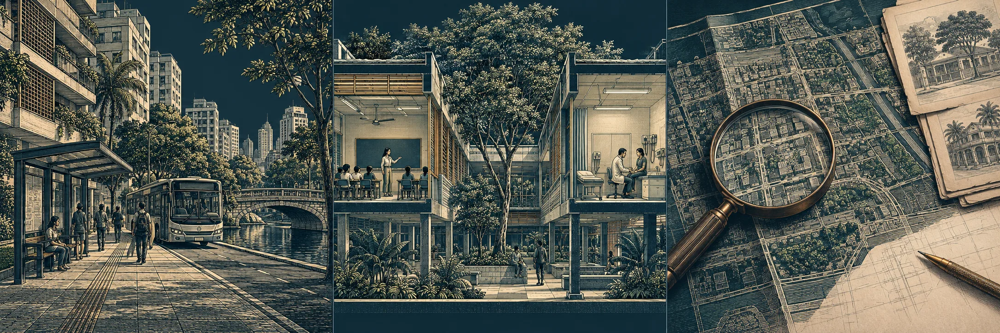
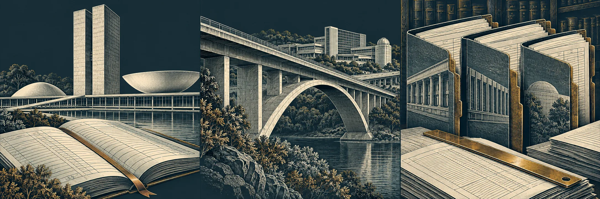
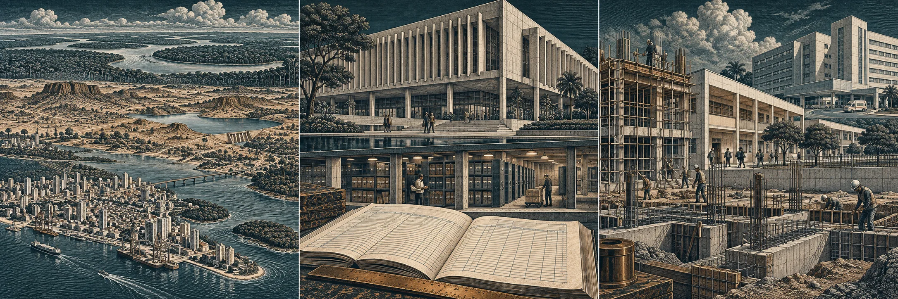

# Arte editorial das três entradas do Estado

Direção revista em 13/10/2026, a pedido do responsável, após a avaliação
de que as miniaturas reaproveitadas de Crédito eram infantis e sem contexto.
Base: PR #167, `main` em `041557f674a64957da4125878ebebfcf31897c3e`.

## Direção de arte

Nove cenas exclusivas, organizadas em três trípticos. Gravura arquitetônica
editorial: perspectiva, proporções humanas, hachuras em marfim, petróleo e
acentos discretos em bronze. A relação com Crédito e Energia permanece na
paleta e na navegação por perguntas; os objetos e as cenas são próprios de
cada assunto. Não se reaproveitam calculadora, casinhas ou prédio genérico.

| Página e destino | Cena | Relação com a leitura |
| --- | --- | --- |
| OBEE · A vida no território | Rua brasileira, transporte coletivo e tecido urbano | Situa as condições de vida no território |
| OBEE · Encontre seu tema | Corte de escola e atendimento de saúde | Apresenta serviços públicos reconhecíveis |
| OBEE · Entenda a cobertura | Planta urbana conceitual examinada com lupa | Remete ao alcance e à verificação da evidência |
| Federal · Acompanhe os recursos | Congresso Nacional e livro de registros | Relaciona orçamento, instituições e prestação de contas |
| Federal · Explore as entregas | Viaduto e instalações de pesquisa | Introduz a dimensão física das entregas públicas |
| Federal · Escolha uma pergunta | Arquivo e cadernos de consulta | Representa a organização dos capítulos e das evidências |
| Estadual · Estados lado a lado | Paisagens urbanas, interior e grandes rios | Expõe diversidade de contextos sem ordenar desempenho |
| Estadual · Por dentro do estado | Edifício administrativo, arquivo e registros | Abre a leitura da execução e condição fiscal |
| Estadual · Do recurso ao serviço | Estrutura em obra, escola e hospital | Conecta a leitura do orçamento às entregas, sem inferir impacto |

As imagens foram geradas por IA sob direção editorial específica e
inspecionadas individualmente. São ilustrações conceituais, não fotografias,
fontes estatísticas, mapas oficiais ou registros de obras. Não se atribui
uma paisagem, edifício ou situação representada a uma UF selecionada. Não há
valores, bandeiras inventadas, legendas de dados ou fluxos quantitativos nas
artes. A interface apresenta essa distinção junto da navegação.

## Pranchas finais

Estas são as artes, **não capturas das páginas no navegador**.

### Eficiência Estatal

### Contas Públicas Federais

### Contas Públicas Estaduais

## Integração e limites

- Cada página usa somente seu tríptico; cada link exibe um terço distinto.
- Cada prancha tem 2172 × 724 pixels, com três cenas quadradas de 724 pixels.
  A conversão para WebP preserva composição e dimensões; não há montagem ou
  corte adicional dos originais gerados.
- Carregamento adiado das imagens, decodificação assíncrona e espaço quadrado
  reservado. Os três links compartilham a mesma URL de imagem por página.
- Até 480 px, cada arte ocupa a largura disponível acima do título, para
  preservar sua leitura. Na faixa intermediária, imagem e texto ficam lado
  a lado; no desktop, os três percursos ficam em colunas.
- Texto fora da imagem; links completos, foco visível e nomes acessíveis
  preservados. Imagens decorativas não repetem a leitura dos títulos no
  leitor de tela. A navegação textual continua utilizável se a imagem falhar.
- Indicadores, séries, números, filtros, bandeiras oficiais, downloads,
  metodologia e pacote congelado OBEE não foram modificados.
- Nenhuma dependência adicionada. A conversão usa o encoder WebP já incluído
  no Next instalado, com qualidade 82. As pranchas têm 484.596 bytes (Federal),
  590.286 bytes (OBEE) e 577.398 bytes (Estadual).

## Verificação da revisão

- Lint sem avisos; TypeScript sem erros; build de produção aprovado.
- 61 testes existentes das aberturas aprovados.
- HTML de OBEE e Federal: três imagens do tema correto, arquivo presente,
  carregamento adiado e descrição decorativa. A rota estadual é dinâmica;
  não foi apresentada como inspecionada por HTML estático.
- Os SHA-256 dos 54 arquivos congelados foram conferidos e preservados.
- Todas as URLs dos nove destinos foram mantidas.

A tentativa de acesso ao navegador nesta rodada expirou. A inspeção das
artes foi realizada pelos arquivos gerados e pela versão WebP do OBEE;
o comportamento final das páginas em diferentes larguras, zoom e teclado
ainda não foi verificado manualmente. Não se atribui nota estética ou
conformidade integral sem essa evidência.
