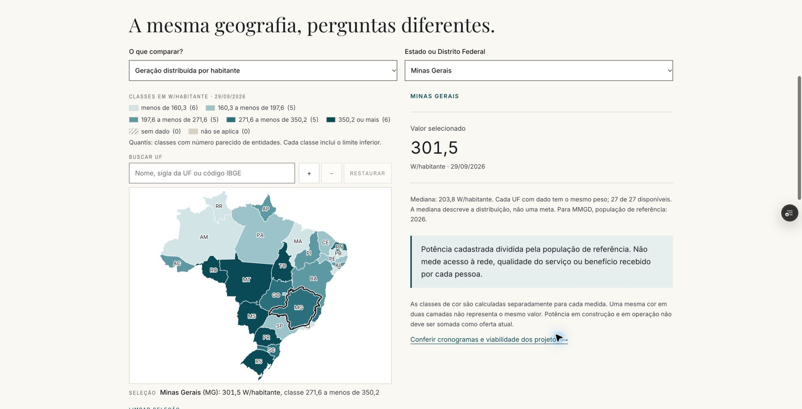

# Energia: operação, contratos, empresas e território

Implementação de 13/10/2026. A página inicial preserva a identidade editorial e passa a distinguir explicitamente o percurso físico da energia dos contratos, pagamentos e da contabilização comercial.

## Perguntas e entregas

| Pergunta | Entrega | Limite explícito |
| --- | --- | --- |
| Onde entra a comercialização? | Duas camadas na abertura e `/setor-eletrico/mercado/comercializacao`, com laboratório de perfil contratual. | Contrato não determina o caminho físico; volumes iguais no dia não eliminam exposição horária. |
| Quanto custa, quem tem, qual qualidade? | Atlas e ligações diretas para tarifas, perdas, continuidade e acesso, preservando a unidade territorial da fonte. | Potência por habitante não mede universalização; média da distribuidora não é valor de cada residência. |
| Onde estão os ativos e projetos? | `/setor-eletrico/territorio/atlas`: quatro camadas sobre geometria oficial, seleção de UF, mediana e tabela equivalente. | MW não é MWh nem investimento em reais; projetos em construção não são oferta disponível. |
| Quem são as empresas e como estão? | `/setor-eletrico/empresas/analise`: seleção de companhia e perímetro; até seis exercícios, lucro, caixa, margem e cadeia de controle. | Não soma controladoras e controladas; não substitui consolidado por individual; não infere relações políticas. |
| Onde investem e ganham dinheiro? | Copel 2025: investimento e EBITDA por segmento, com transcrição rastreável; Equatorial: estratégia atribuída ao RI. | São dois estudos documentados, não análises setoriais exaustivas. Estratégia declarada não prova execução ou retorno. |
| Como avaliar novos riscos? | `/setor-eletrico/transicao/riscos`: curtailment observado/estimado pela fonte, cinco mecanismos, laboratórios de bateria e data center. | Cenários hipotéticos não são previsão de PLD, estudo de viabilidade nem perda climática por ativo. |

## Convenções e fórmulas

- Comercialização: saldo de cada bloco = contrato − consumo; resultado no MCP = soma(saldo × PLD). Custo de energia do exercício = contrato × preço contratual − resultado no MCP. Mesmo submercado, sem perdas, tributos, encargos, modulação real ou efeitos de garantias. Quatro blocos de seis horas, com volumes em MWh por bloco e preços hipotéticos.
- Bateria: a energia informada é a saída útil em corrente alternada. Entrada = saída/rendimento de ida e volta; duração = MWh/MW; margem bruta = saída × venda − entrada × compra. Não inclui CAPEX, degradação, conexão ou outros serviços.
- Data center: MW médios = potência nominal de TI × utilização média × PUE; GWh anuais = MW médios × 8.760/1.000. PUE é energia total/energia de TI. Não infere realização de pedidos de conexão.
- Empresas: R$ milhões nominais; exercício anual, mesmo CNPJ e perímetro. Percentuais anuais exigem ano consecutivo e base estritamente positiva. Mudanças de lucro para prejuízo usam diferença absoluta. Ausências permanecem nulas. EBIT não é EBITDA; fluxo de investimento não é CAPEX; operações + investimento não é fluxo de caixa livre padronizado.
- Atlas: potência fiscalizada de operação e outorgada de construção (SIGA), potência cadastrada e W/habitante (MMGD). Classes de cor próprias de cada medida, ausências distintas de zero, mediana com igual peso por UF disponível, datas de cada camada preservadas.

## Fontes e rastreabilidade

As páginas exibem as referências técnicas primárias e os links para os módulos que contêm os registros e evidências. Os dados estruturados existentes permanecem a fonte dos indicadores: CVM, ANEEL, ONS e população de referência da base.

O arquivo `public/energia/estudos/copel-2025.json` registra unidade, período, URL, seção, natureza e método de extração da informação adicional. Os totais dos segmentos são reconciliados em teste. O Formulário de Referência 2026 foi disponibilizado pela Copel à SEC em 23/03/2026; as cifras usadas se referem a 2025 e 2024. Esta transcrição não recebe atualização automática: nova edição exige revisão da fonte, metadados e teste.

O uso de vínculos societários não estabelece beneficiário final, favorecimento, conexão política ou causalidade econômica. Não há score de desempenho empresarial. Perda esperada por ativo exigiria, além de ameaça e geolocalização, vulnerabilidade e atribuição verificadas; essa medida permanece fora da publicação.

## Verificação

- Testes de conservação de energia, sinais da liquidação, exposição temporal, hipóteses inválidas e comparabilidade contábil.
- Reconciliação de todas as séries de companhias ativas com as contas de origem, sem troca de perímetro ou preenchimento de ausências.
- Reconciliação do investimento e EBITDA segmentado da Copel.
- TypeScript, lint e compilação de produção concluídos.
- Filtros e hipóteses são serializados no endereço pelo mecanismo de estado já utilizado no observatório.

## Revisão da prévia

A compilação, o lint, os tipos, os testes Python e a suíte completa passaram no CI do commit `1054bb7261b03fd72232b90c2ed4d5a755fd8bc2` (execução 38328240127). A execução local completa encontrou somente dois arquivos brutos de Contas Públicas ausentes do checkout; esses arquivos estão presentes no CI remoto, que passou.

Inspeção manual no Chrome:

- 1440 px: hierarquia, camadas física/comercial, mapa e laboratório de contratos.
- 768 px: filtros e disposição do atlas.
- 390 e 320 px: controles e leitura; páginas de comercialização, empresas, atlas e riscos sem transbordamento horizontal da página. As tabelas preservam sua própria rolagem.
- Ampliação real de 200%: laboratório de flexibilidade reorganizado em 720 px úteis, sem transbordamento; zoom e tamanho do navegador restaurados.
- Contratos: troca do perfil uniforme para o perfil casado reduz o ajuste de R$ 5.250 de débito para zero; restauração recupera o cenário inicial.
- Atlas: Minas Gerais resulta em 301,5 W/habitante de MMGD e 69 MW outorgados em construção; troca de camada, seleção e zoom conferidos.
- Empresas: troca de Neoenergia para Copel e de consolidado para individual; seis exercícios e links mantêm o CNPJ e o perímetro selecionados.
- Flexibilidade: bateria de 200 MWh úteis e 50 MW dura quatro horas; data center de 100 MW de TI, 80% de uso e PUE 1,35 resulta em 108 MW médios e 946,1 GWh anuais apresentados.

Produção não alterada por esta revisão. Os limites de cobertura descritos acima continuam aplicáveis.
