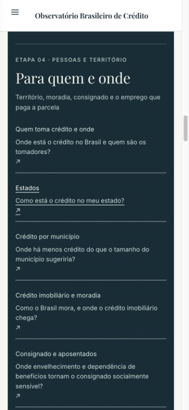
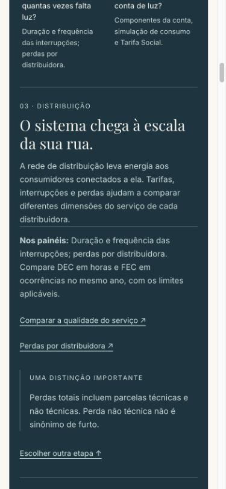
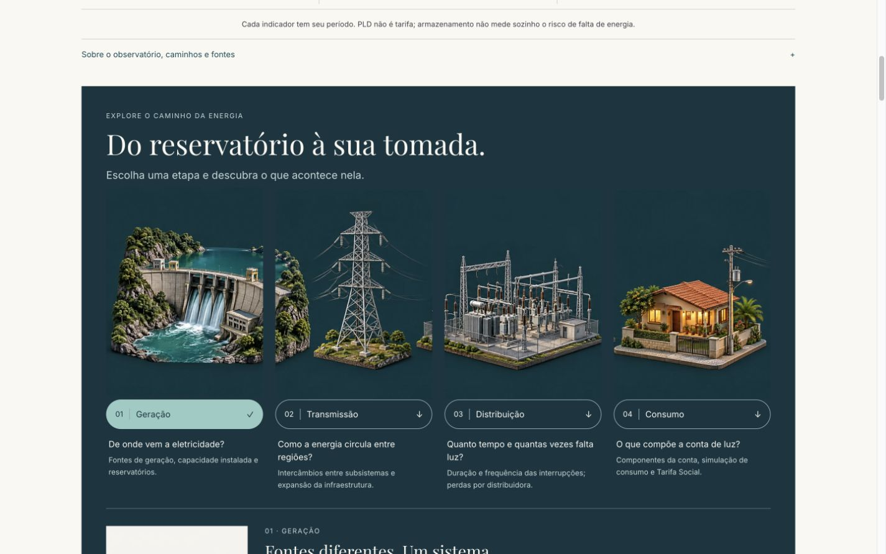
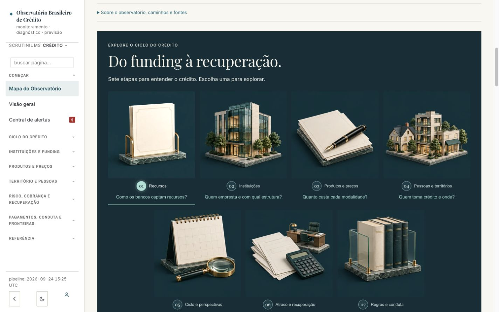
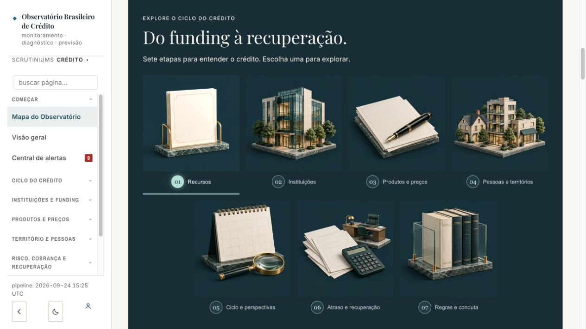
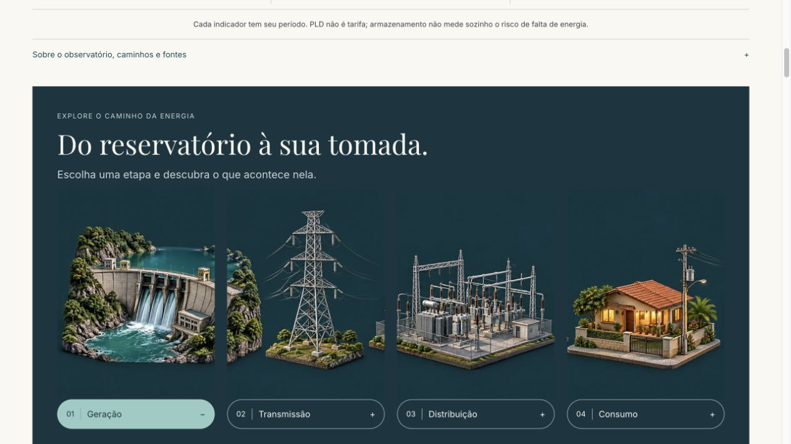

# Revisão de experiência — Crédito e Energia

11/10/2026. Implementação sobre main `c02b614529ad382c9bcfc13e01a53292e22fe51a`.

## Problemas corrigidos

| Tela | Problema encontrado | Resultado |
|---|---|---|
| Crédito, maquete | Habitação, Empresas e Famílias abriam a mesma etapa genérica | Habitação abre seu painel; Empresas e Famílias abrem o panorama com PJ/PF explícitos na URL |
| Crédito, comparação | Card prometia comparar, mas abria a listagem | Abre o comparador, com conteúdo e perímetro descritos antes do clique |
| Crédito, indicadores | Conceito ficava escondido; faltava caminho para a análise | Três números com definição curta visível, unidade, fonte, período e aprofundamento coerente |
| Crédito, sete etapas | Cards só nomeavam temas e links só nomeavam páginas | Pergunta em cada etapa; 38 destinos com perguntas do guia canônico; hierarquia H2/H3 |
| Energia, quatro etapas | Botões e URL divergiam; clicar novamente no mesmo hash não restaurava a seleção | Seleção sincronizada; tratamento de clique repetido, hashchange e popstate com limpeza dos listeners |
| Energia, seis análises | Mesmo problema entre atalhos da abertura e seleção local | Atalhos restauram a análise correta; mostrar todas continua disponível |
| Energia, mapa | Atalho levava ao título de um conteúdo ainda fechado | Mapa abre pelo atalho e pelo link direto |
| Energia, catálogo | Recorte dos 20 destinos ficava escondido | Pergunta e recorte visíveis antes do clique; detalhamento preservado |
| Dois painéis, celular | Seleção de etapa deixava a resposta várias telas abaixo | Toque leva à resposta; foco no título; link para escolher outra etapa |
| Comparador de crédito | Texto fixo informava cinco períodos e repetia ações como links sem destino | Total vem do catálogo; instrução única usa os botões existentes |

## Verificação

- **104 testes aprovados**, em seis arquivos: crédito atlas; energia percurso, inicial, âncoras, navegação e mapa. Novos testes cobrem clique repetido no mesmo hash, modificadores, popstate, limpeza e preservação do estado do roteador.
- TypeScript sem erros; `node --check` nos scripts; geração do bundle de crédito concluída.
- Inspeção das iniciais em produção, seguida de validação local no navegador.
- Todas as sete etapas de crédito, quatro etapas de energia e seis análises da inicial alternam corretamente; sempre uma resposta visível, ou seis no modo de mostrar todas.
- Busca de energia: ausência explicada, resultado por reservatórios e abertura pelo teclado da página Água e clima, na seção p017.
- Empresas abre PJ. Card de comparação abre `/observatorio/compare`; botão “5 grandes bancos” monta a comparação com cinco instituições.
- Inventário dos links renderizados das iniciais, incluindo conteúdo recolhido: **153 links / 49 destinos distintos** em crédito e **334 / 164** em energia. Rotas internas conferidas contra o roteador e páginas existentes; nenhuma rota ausente nessa verificação. Isso não equivale a clicar em todos os links nem a validar todas as âncoras das páginas de destino.
- Reflow nos viewports solicitados de 320, 390, 768 e 1440 px: sem transbordamento material da página. Em energia a 768 px, diferença subpixel de 1 px. Artefatos e texto inspecionados em desktop e celular.
- Preservados dados, unidades, períodos, cálculos, laboratórios, catálogo completo, fontes, exportações existentes e limites metodológicos.

## Autoavaliação por página

Escala da skill Observatório Layout. Não é revisão independente ou certificação de acessibilidade.

| Critério | Crédito — inicial | Energia — inicial | Evidência / limite |
|---|---:|---:|---|
| Direção de arte | 9 | 9 | Artefatos preservados, acabamento editorial consistente |
| Hierarquia | 9 | 9 | Perguntas, contexto e destinos explícitos |
| Tipografia e acabamento | 8 | 9 | Crédito mantém densidade alta em alguns destinos longos |
| Densidade e profundidade | 9 | 9 | Detalhes e catálogo preservados, recortes mais visíveis |
| Didática visual | 9 | 9 | Conceitos, artefatos e perguntas complementares |
| Comparabilidade | 9 | 9 | Universos e períodos preservados; limites junto à medida |
| Interação e acessibilidade | 8 | 8 | Tarefas principais e teclado verificados; leitor de tela e zoom de 200% não verificados |
| Responsividade | 9 | 9 | Quatro larguras e resposta acessível após seleção |

## Limites de cobertura

Não foi feita auditoria manual exaustiva de todos os filtros, downloads, cards e estados de todas as subpáginas dos dois observatórios. A revisão implementada cobre as iniciais, sua navegação e uma inconsistência no comparador. Não se afirma ausência universal de bugs. As capturas são locais; publicação em produção não integra esta entrega.

## Capturas após as correções

## Referência em produção antes das correções

As capturas anteriores usam o viewport que estava aberto durante o diagnóstico, diferente das capturas responsivas da versão corrigida.

