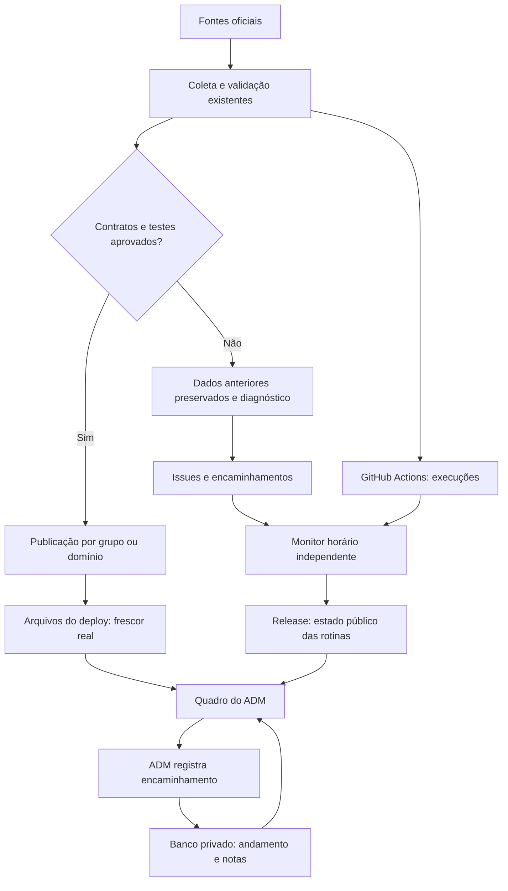

# Atualização dos dados e operação do ADM

27/10/2026. Base examinada: `8a7cd80b27e5110f0024236fc73ae1fabb61de69`. Escopo: item 1 da avaliação do conselho, aplicado ao acompanhamento e à automação. Nenhuma fórmula, taxonomia, fonte, regra de acesso ou gold foi alterada. Sem merge ou publicação nesta etapa.

## Decisão de arquitetura

O quadro deve continuar informando uma falha mesmo quando ela impede a publicação. Por isso, o estado das rotinas não é embutido no build do site. Um monitor horário grava apenas metadados já públicos em uma release própria. O servidor do ADM lê esse estado com prazo de validade, sem segredo novo e sem encaminhar credenciais ao navegador.

São três contratos distintos: **frescor dos dados publicados**, **resultado da automação** e **encaminhamento humano**. Nenhum substitui o outro. O monitor não lê dados de contas, conteúdo de logs nem corpo de issues. Notas do ADM ficam no banco já usado pela aplicação e nunca passam pela release pública.

## O que passa a ser automático

1. Acompanhamento das 23 rotinas cadastradas: coleta, vigílias, previsão, e-mails e depósito de pesquisa, sem abrir 23 páginas do Actions. O catálogo liga as rotinas aos 13 domínios com regra de frescor. Não são 23 fontes nem 13 coleções: várias fontes e coleções compartilham um domínio operacional.
2. Formação da fila a partir de falhas/cancelamentos, issues abertas e PRs de dependência. Reexecuções são identificadas pelo par execução/tentativa. A conclusão de uma tentativa antiga não oculta outra com falha.
3. Validação do HTML da candidata em cada rodada de composição do Crédito, com `EXIGIR_BUILD_HTML=1` e heap adequado; o mesmo preparo precede a suíte de Energia. O diagnóstico Python continua mesmo quando o build falha. Falha de build bloqueia publicação, sem aproveitar HTML antigo.
4. Atualização do quadro sem commit de status, deploy do site, token de GitHub na Vercel ou intervenção do ADM. Cache de cinco minutos; monitor com mais de três horas é explicitamente histórico.

## O que continua manual e por quê

| Trabalho | Parte já automática | Ato humano necessário |
|---|---|---|
| Falha temporária de fonte | Tentativas limitadas e preservação da publicação anterior nos coletores existentes | Examinar erro persistente e eventual alteração de contrato; não repetir indefinidamente bloqueios ou dados inválidos |
| SIGA/retratos de Energia | Coleta, retenção e diagnóstico | Revisar/integrar o PR #379 e conferir a candidata; este PR não duplica aquela mudança de método |
| RTN e edições fiscais | Detecção de edição nova e issue; SIOP/BCB nos recortes já integrados | Conferir edição, base de preços e anos antes de promover a nova captura |
| SINISA, CadÚnico e documentos de contratos | Coleta/monitoramento nos recortes configurados | Integrar edição/competência ou documento com conferência do contrato |
| Contas estaduais | Vigília das fontes e testes da captura | Promover captura revisada por período |
| Consulta ao BCB | Ressalvas e validação dos recortes do pacote C | Pedir documentação do 0,00% e do tipo 4; registrar resposta e decisão |
| E-mails e Zenodo | Rotinas de envio ou preparo e estado de execução | Configuração e decisões do mantenedor; envio real e publicação de depósito exigem o procedimento próprio |

Automatizar a promoção dessas mudanças sem conhecer o contrato reduziria a confiabilidade. A fila registra a ação necessária e o responsável, e o catálogo torna visível o limite da automação em cada área.

## Persistência e controles

- Mesma autorização administrativa no servidor, inclusive antes do streaming de metadata; conta comum recebe 404 da página.
- API de escrita exige sessão administrativa e Origin correspondente ao host; corpo limitado e contrato validado.
- Andamento, prazo, responsável e nota na tabela `tarefas_operacao`; migração idempotente com versão por hash.
- Versão otimista impede sobrescrita por outra sessão. Alteração e auditoria são atômicas; o log contém somente id, estado e versão, além do autor administrativo.
- Concluir tarefa não fecha issue, não integra PR, não altera data e não dispara publicação. Uma evidência que permanece ativa continua assinalada.
- Falha de monitor não apaga tarefas salvas. Um histórico sem sinal atual não é anunciado como causa resolvida.
- Primeira ativação: após integrar o PR e publicar o site, executar ou aguardar o workflow `Atualizar quadro do ADM` na `main`. Até lá, a interface informa monitor indisponível.

## Continuidade recomendada

Usar este quadro para priorizar as causas recorrentes antes de ampliar cadências. O próximo ganho maior de atualização efetiva depende de integrar e verificar o PR #379, seguido da integração da edição do RTN já detectada. Este trabalho não comprova que essas bases voltaram a atualizar. A consulta observada do GitHub está preservada em `estado-observado.json`; ela é datada, não evidência de produção futura.
